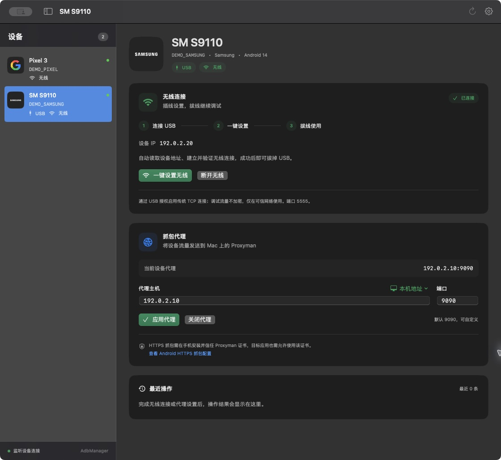

# AdbManager



*截图使用演示设备和示例网络地址。*

原生 SwiftUI macOS Android 设备管理工具，支持多设备、插线后一键建立无线 ADB 连接，以及 Android 全局 HTTP 代理设置。最低系统版本为 macOS 14。

当前版本：**1.0.9**（构建号 10）。

本版让品牌 Logo 跟随系统深浅外观：有官方反白版本的品牌自动切换，Google 彩色 G、小米橙底白标和 Lenovo 红框标识共用原图，承载底色随主题调整。矢量标识保留 PDF 轮廓，位图保留原始像素。HONOR 暂未取得可靠深色版本，深色时仍以浅灰底承载官方黑字，保证可读；Sony 暂未取得官方浅色黑字版本，浅色时保留深底白字。侧栏宽度过渡和设备刷新策略不变。

品牌识别优先读取手机上报的 `ro.product.brand`，无法识别时再使用 `ro.product.manufacturer`。内置 Samsung、Google、Xiaomi、Huawei、Honor、OPPO、vivo、OnePlus、Motorola、Lenovo、Sony、ASUS 共 12 个品牌的官方离线 Logo；Nokia 暂未取得可信的手机品牌官方素材，和未知品牌一样回退 Android 图标，不使用 Nokia 网络公司的新标识代替。原件、来源 URL、SHA-256 与转换记录见 [品牌资源说明](Assets/DeviceBrands/README.md)。

## 刷新方式

- 设备列表采用事件驱动：底层通过 `adb track-devices` 监听新设备接入、已有设备断开，以及授权或在线状态变化；不会定时扫描设备列表。
- 监听进程异常退出后会退避重连，恢复事件监听，不会改为轮询设备列表。
- 已知设备的详情、IP 和代理状态每 60 秒更新一次。
- 手动刷新作为兜底入口，点击后立即读取设备列表及全部设备信息。

## 构建与运行

准备以下环境：

- macOS 14 或更新版本。
- Swift 6 工具链；当前验证环境为 Xcode 26 / Swift 6.2。可以使用完整 Xcode，或包含相应 Swift 工具链的 Command Line Tools。
- Android SDK Platform Tools（`adb`），以及至少一台开启 USB 调试的 Android 设备。运行单元测试不需要连接手机。

克隆仓库后，在项目根目录构建：

```bash
cd AdbManager
./scripts/build-app.sh
open dist/AdbManager.app
```

构建脚本只在当前项目的 `.build/`、`dist/` 生成文件，不会安装到 `/Applications`，也不会自动启动应用。生成的 `.app` 可移至其他目录。应用使用本机现有的 ADB，不会捆绑或升级 Android SDK。

使用 Xcode 开发时，打开项目根目录的 `Package.swift`，选择 `AdbManager` scheme。正式运行建议使用构建脚本生成的 `.app`，脚本会同时组装图标及品牌资源。项目没有第三方 Swift Package 依赖。

应用会检查常见 SDK、Homebrew 与 `PATH` 中的 ADB 路径；找不到时可在界面中手动选择 `adb` 可执行文件。应用不启用 App Sandbox，以便运行用户指定的本地 ADB 工具。当前产物采用本地 ad-hoc 签名；对外分发时需要 Developer ID 签名与公证。

运行核心测试：

```bash
swift test
```

## 一键无线连接

1. 手机与 Mac 接入可相互访问的网络。
2. 插入 USB，打开手机“USB 调试”，并允许当前电脑的调试授权。
3. 在设备列表中选中目标设备，点击无线连接按钮。
4. 应用自动读取设备 Wi-Fi IP，启用 ADB TCP 监听，建立无线连接，并验证对应设备身份；成功后即可拔掉 USB。

此功能采用 Android 官方支持的 **USB 初始化无线连接流程**：`adb tcpip 5555` 后连接设备 IP 的 5555 端口。它与 Android 11 及以上的“无线调试 / 配对码”TLS 连接方式不同，不依赖 mDNS 自动发现，也不需要手动读取配对码或随机端口。该传统 TCP 调试流量不加密，仅用于可信网络。

只有已授权的 USB 连接可以执行初始化。只有无线连接、设备未授权或离线时，界面会说明原因；它不会把另一个设备作为操作目标。网络存在客户端隔离或防火墙限制时，应用无法绕过网络策略。手机 Wi-Fi 地址变化或重启后，需要重新插线初始化。

官方流程：[Android ADB：初始 USB 连接后通过无线连接设备](https://developer.android.com/tools/adb#wireless)。

## Proxyman 代理

1. 在 Mac 上打开 Proxyman，并确认其监听端口。默认端口为 **9090**。
2. 选中需要抓包的 Android 设备，填写手机可访问的 Mac 局域网 IP；应用也会提供本机地址候选。
3. 保持默认 9090 或填写自定义端口，应用代理设置。
4. 结束抓包后点击关闭代理，避免手机继续连接已关闭的代理服务。

代理设置通过 ADB 写入 Android 全局 HTTP 代理；它不会更改 Mac 系统代理或 Proxyman 应用设置。部分网络库、VPN 和应用可能不遵守 Android 全局代理，因此“设置成功”不等于所有流量均会经过 Proxyman。

HTTPS 抓包还需要安装并信任 Proxyman CA 证书，以及让被调试应用信任用户证书；仅配置代理并不足以解密 HTTPS。AdbManager 不自动安装证书或修改被调试应用的证书策略。请参照 [Proxyman 官方 Android 指南](https://proxyman.com/docs/debug-devices/android-device)。

## 代码组织

- `Sources/AdbManagerCore/`：命令执行、ADB 设备模型、设备与网络操作，独立于 SwiftUI。
- `Sources/AdbManager/`：原生应用入口、界面状态与 SwiftUI 视图。
- `Tests/AdbManagerCoreTests/`：解析、参数校验、设备目标和操作流程的核心测试。
- `Assets/`：Android 官方原始 SVG、PNG、macOS 图标，以及 `DeviceBrands/` 中的离线品牌 Logo 与来源说明。
- `Support/Info.plist`：应用元数据。
- `scripts/build-app.sh`：Swift Package 构建与 `.app` 组装。

界面与 ADB 核心分层，后续可在核心中增加设备命令并在视图层增添入口。所有设备命令均使用明确目标，避免多设备环境中误选设备。

## 图标来源

图标使用用户指定的 [Android 官方 3D 头像 SVG](https://developer.android.com/static/images/brand/android-head_3D.svg)。项目保留原始 SVG；PNG 与 `.icns` 由同一 SVG 等比渲染生成，没有重画或替换图案。

## 开源许可与第三方素材

项目代码采用 [MIT License](LICENSE)，允许在保留版权和许可声明的前提下使用、修改及分发。

Android 机器人、手机品牌 Logo、字体和官方原始设计素材不属于本项目的 MIT 授权范围，其版权、商标及其他权利归各自权利人所有。请阅读 [第三方素材声明](THIRD_PARTY_NOTICES.md) 与 [品牌资源来源清单](Assets/DeviceBrands/README.md)。项目仅用这些标识区分设备，不表示得到相关品牌的认可或背书，也不授予其商标使用权。

仓库包含应用所需的 `Assets/DeviceBrands/Runtime/` 官方标识及来源、哈希和转换记录；普通构建直接使用这些资源，不需要下载原件。原始 AI、EPS、字体和设计包位于本机 `Assets/DeviceBrands/Originals/`，不随源码仓库分发。

只有需要重新生成品牌素材时，才需按 `official-*.json` 来源清单自行取得原件、放入对应 `Originals/` 路径，再手动执行：

```bash
swift scripts/prepare-brand-assets.swift Assets/DeviceBrands
```

准备脚本会校验原件哈希。下载得到的文件与清单哈希不一致时，应先核对官方素材是否变更，不要跳过校验。
